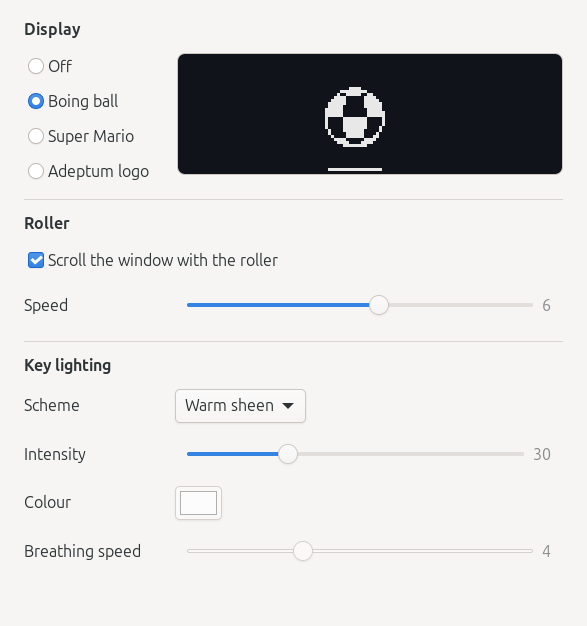
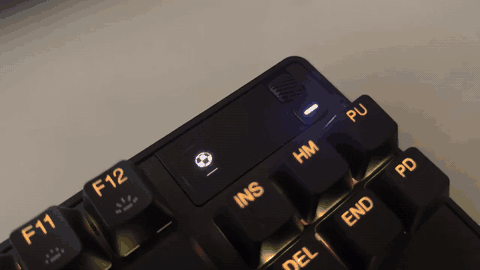

# Keysteel



An unofficial Linux companion for SteelSeries keyboards, in the spirit of
SteelSeries GG. Keysteel runs quietly in the background from the moment you
log in to your desktop and lets you configure your keyboard without Windows.

The first target device is the **Apex Pro TKL** with its OLED display.

> Keysteel is an independent project. It is not affiliated with, endorsed by
> or supported by SteelSeries or Nintendo. SteelSeries and Apex are
> trademarks of SteelSeries. Super Mario is a character of Nintendo; the
> Mario scene is a fan tribute. The Adeptum logo belongs to Adeptum AB.

## What it does

- Shows scenes on the OLED display: an Amiga Boing ball, Super Mario
  running and jumping over pipes and onto brick platforms in a level that
  never repeats, and the Adeptum logo scrolling across the screen. "Off"
  gives the screen back to the keyboard's own display.
- Lights the keys from presets: a very faint warm yellow sheen, one solid
  colour, a slow breathing, all dark, or the keyboard's own scheme. The
  intensity, colour and breathing speed are adjustable.
- Turns the roller in the corner into a mouse wheel, with a speed you can
  set.
- Picks all of this from a small desktop app.

## See it



A [full quality video](docs/demo.mp4) is in the repository too (no sound).

## Supported

- Keyboard: the **SteelSeries Apex Pro TKL Gen 3** (USB `1038:1642`) over
  USB. It is tested on the ISO layout only. Other keyboards, the wireless
  models and the ANSI layout are untested.
- System: Linux Mint 22 or Ubuntu 24.04 and newer on amd64. The app needs
  GTK 4.10, which older releases do not have.

## Installing

Download the `.deb` from the
[releases page](https://github.com/adeptum-labs/keysteel/releases) and install
it:

```
sudo apt install ./keysteel_0.1.1-1_amd64.deb
```

Unplug the keyboard and plug it in again (or log out and in) so the new
permissions apply. The daemon starts at every login. Start **Keysteel** from
the application menu. Remove it with `sudo apt remove keysteel`.

## Using it

Pick a scene, a lighting preset and the roller setting in the window. The
daemon has to be running; the window says so and offers Retry if it is not.

Everything can also be set from a terminal, through the daemon's D-Bus
service on the session bus:

```
busctl --user call org.keysteel.Daemon /org/keysteel/Daemon \
    org.keysteel.Daemon SetScene s boing
```

The scene ids are `off`, `boing`, `mario` and `adeptum`.

The lighting arguments are the scheme (`warm`, `solid`, `breathing`, `off` or
`default`), the intensity from 0 to 100, red, green and blue, and the
breathing speed from 1 to 10:

```
busctl --user call org.keysteel.Daemon /org/keysteel/Daemon \
    org.keysteel.Daemon SetLighting syyyyy warm 30 255 255 255 4
```

The lighting stays on while the daemon runs. Stop the daemon and the keyboard
goes back to its own lighting.

The roller changes the volume until you tick "Scroll the window with the
roller" in the app, or run `SetRollerScroll b true`. The speed (1 to 10
notches per click, 3 by default) is `SetRollerSpeed u 5`. The scene, the
lighting and the roller settings are all remembered.

By default the keyboard draws its own status text over the top 12 rows of
the OLED. Turn off "display icons" in the keyboard's OLED menu to use the
whole 128x40 screen. Keysteel cannot change that option: it is only
available from the keyboard.

## Permissions

The package installs a udev rule that gives the logged-in user access to
the keyboard's control interface, to its media key input device (which the
roller uses) and to `/dev/uinput` (to create the virtual mouse wheel). The
typing keys are not opened. Note that access to `/dev/uinput` lets any
program you run create virtual input devices.

## Building from source

You need a recent stable Rust toolchain, plus the development files for
libudev and GTK 4.10 or newer (`libudev-dev` and `libgtk-4-dev` on Debian
and Ubuntu).

```
packaging/install.sh
```

The script installs the daemon for your user, starts it as a systemd user
service, and installs the app when the GTK 4 development files are found. It
then prints the one command that needs root: installing the udev rule.

To build the `.deb` yourself, install `cargo-deb` and run
`packaging/deb/stage.sh`.

## How it is built

- Written in Rust.
- A **background daemon** owns the keyboard. It draws the scenes, applies
  the lighting, handles the roller and offers the D-Bus service
  `org.keysteel.Daemon`. It starts at login as a systemd user service, or on
  demand through D-Bus activation, and sleeps when nothing is animating.
- A **desktop app** (GTK 4), started from the application menu, talks to
  the daemon over D-Bus. It has no tray icon.
- Primary desktop target: Linux Mint (Cinnamon).

## License

Copyright © 2026 Adam Waldenberg and Adeptum AB, Org.nr 559494-1824.

Keysteel is free software: you can redistribute it and/or modify it under
the terms of the GNU General Public License as published by the Free
Software Foundation, either version 3 of the License, or (at your option)
any later version. See the [LICENSE](LICENSE) file for the full text.
